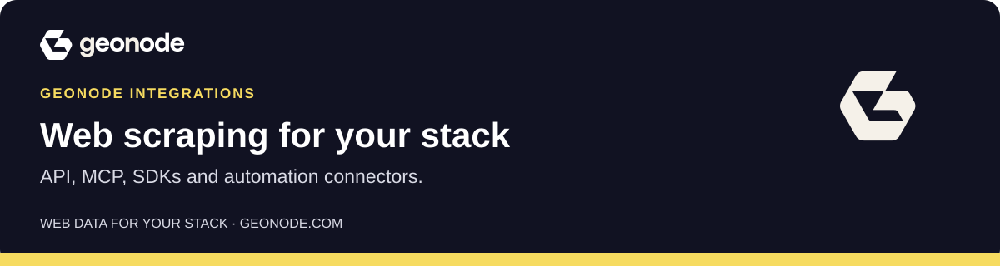

# Geonode Integrations

Web data for your applications, AI agents and workflows. Extract readable page content, discover URLs, and connect the results to the tools you already use.

**[Create an account →](https://app.geonode.com/sign-up)** &nbsp; · &nbsp; [Documentation](https://docs.geonode.com/docs/scraper-api) &nbsp; · &nbsp; [Geonode](https://geonode.com)

[Start here](#start-here) · [SDKs](#sdks) · [Agent frameworks](#agent-frameworks) · [Automation](#automation) · [Proposed integrations](#proposed-integrations) · [Catalog](#machine-readable-catalog)

## Start here

| Connection | Choose it when | Documentation |
| --- | --- | --- |
| **API** | You're building an application in any language. | [REST API reference](https://docs.geonode.com/docs/scraper-api/v1/reference) |
| **MCP** | Your AI assistant needs to read and work with web data. | [MCP setup guide](https://docs.geonode.com/docs/scraper-api/guides/mcp/00_overview) |
| **CLI** | You're working in a terminal or automating a shell script. | [CLI on PyPI](https://pypi.org/project/geonode-scraper-cli/) |

**Your first connection:** create a Geonode account, get an API key from the [dashboard](https://app.geonode.com/), then follow one setup guide and test a single URL.

MCP also supports limited anonymous page extraction. [Try MCP without a key →](https://docs.geonode.com/docs/scraper-api/guides/mcp/01_use-without-an-api-key)

## SDKs

Use typed clients in your application.

| Integration | Use it for | Start building |
| --- | --- | --- |
| **Python SDK** | Typed requests and responses in Python. | [Geonode guide](https://docs.geonode.com/docs/scraper-api/developer-guides/python-sdk) · [PyPI](https://pypi.org/project/geonode-scraper-sdk/) |
| **TypeScript SDK** | Typed API calls from server-side JavaScript or TypeScript. | [npm & setup](https://www.npmjs.com/package/@geonode_scraper/scraper-sdk) |

## Agent frameworks

Give an agent tools to extract pages, map sites, search the web and work with longer jobs.

| Integration | Use it for | Start building |
| --- | --- | --- |
| **LangChain** | Native tools for LangChain agents and workflows. | [Geonode guide](https://docs.geonode.com/docs/scraper-api/developer-guides/langchain) · [PyPI](https://pypi.org/project/geonode-scraper-langchain/) |
| **CrewAI** | Native tools for CrewAI agents and tasks. | [Geonode guide](https://docs.geonode.com/docs/scraper-api/developer-guides/crewai) · [PyPI](https://pypi.org/project/geonode-scraper-crewai/) |

<strong>Building your own Python adapter?</strong>

**Agent tools core** provides shared schemas, request handling, polling and an operation registry above the Python SDK. LangChain, CrewAI and the CLI install it as a dependency.

Install it directly when building a custom adapter. It is a Python library, not an MCP server.

[View agent tools core on PyPI](https://pypi.org/project/geonode-scraper-tools-core/)

## Automation

Bring extracted content into a workflow and send it to the next step.

| Integration | Use it for | Start building |
| --- | --- | --- |
| **n8n** Self-hosted community node | Extraction and completion triggers in n8n workflows. | [npm & setup](https://www.npmjs.com/package/n8n-nodes-scraperapi) |
| **Make** Private app | Plan an extraction step in a Make scenario. | [Discuss access](https://geonode.com/contact) |
| **Zapier** Private app | Plan an extraction step in a Zap. | [Discuss access](https://geonode.com/contact) |

**n8n:** the community node supports self-hosted installations. This listing does not provide n8n Cloud access. **Make and Zapier:** private apps; [contact Geonode](https://geonode.com/contact) to confirm access and supported actions.

## Proposed integrations

We're exploring more SDKs, frameworks and workflow tools. [Tell us which connection would help you](https://geonode.com/contact).

Explore the integrations under consideration

- **SDKs:** Go SDK, Java SDK, Rust SDK, Ruby SDK, PHP SDK, .NET SDK.
- **Agent frameworks:** LlamaIndex, OpenAI Agents SDK, Vercel AI SDK, Mastra.
- **Automation and data:** Dify, Coze, Pipedream, Google Sheets, Airbyte, Snowflake, BigQuery, Amazon S3.

These are proposals, not released integrations or committed launch dates. The catalog below covers the current inventory; proposed connectors do not have install commands or package listings yet.

## Machine-readable catalog

[**Open catalog.json →**](./catalog.json)

The 12 current records include package versions, installation commands, documentation links, compatibility and review dates. Availability is recorded separately from verification: a published package does not establish a successful end-to-end connection test.

For programmatic use, check `lifecycle`, `installation.status` and `verification` before choosing an installation path. A null source or package link means no public destination is listed.

The agent setup guide is currently in review; use the [current MCP documentation](https://docs.geonode.com/docs/scraper-api/guides/mcp/00_overview) for assistant setup.

## Account, usage and support

Authenticated requests use your Geonode plan and limits. [Read the API pricing guide](https://docs.geonode.com/docs/scraper-api/additional-resources/pricing). Assistants and automation platforms may have separate subscriptions.

**[Create your account](https://app.geonode.com/sign-up)** &nbsp; · &nbsp; [Get help](https://geonode.com/contact) &nbsp; · &nbsp; [Browse all integrations](https://geonode.com/integrations)
